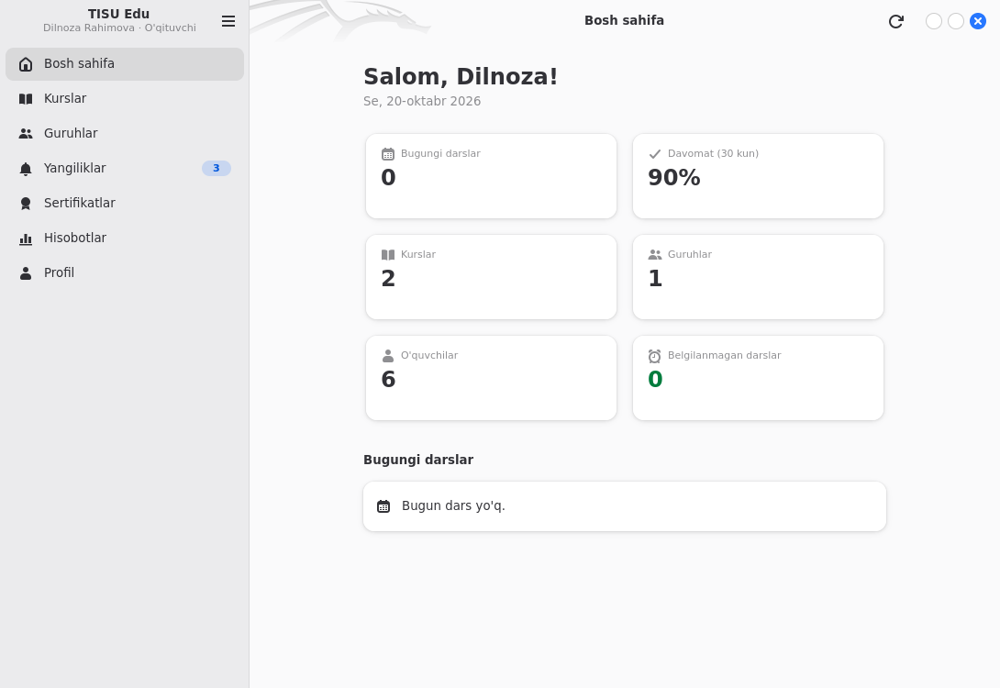
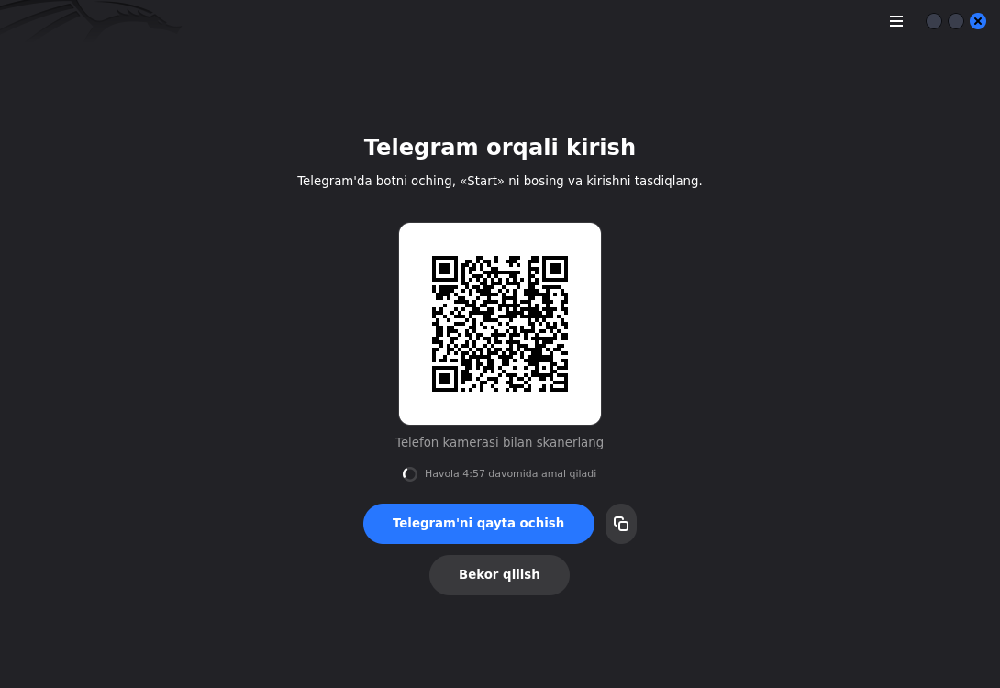

# TISU Edu — Linux desktop app

Native GNOME app for the TISU Edu platform, built with **GTK 4 + libadwaita** and
following the GNOME Human Interface Guidelines: adaptive split view (works down to
360 px wide), light/dark following the system, toasts, status pages for empty /
error / offline states, keyboard shortcuts and an About dialog.

App ID: `uz.uzstudents.tisu` · API: `https://api.tisu.uzstudents.uz/v1`





## Why Python + PyGObject

Rust (gtk4-rs) was the other option, but no Rust toolchain is available on the build
host, and Python adds **zero extra dependencies**: PyGObject, GTK, libadwaita, libsoup 3
and libsecret are all part of the GNOME Flatpak runtime and are packaged by
Debian/Ubuntu. HTTP goes through **libsoup 3 on the GLib main loop**, so every request is
asynchronous without threads and the UI never blocks.

## Features

| Area | What it does | Who sees it |
| --- | --- | --- |
| Sign-in | Telegram deep link (opens the bot and shows a QR code to scan with the phone, polls `/auth/telegram/poll`, countdown) or phone + password | everyone |
| Session | Token stored in the Secret Service (GNOME Keyring / KWallet / Flatpak secret portal); any `401` returns to the login screen | everyone |
| Overview | Greeting, stats, today's lessons, lessons with missing attendance; refreshes every `ui.refresh_seconds` while visible | everyone (stats by role) |
| Courses | Courses → modules → lessons → materials; prev/next lesson; locked courses show the API's `COURSE_ACCESS_DENIED` title, text and contact button | `course.view` |
| Quizzes | Take a quiz (single / multiple / text answers), countdown with auto-submit, result and answer review; managers see questions + results | `quiz.take` / `quiz.manage` |
| Groups | Groups, group detail (schedule, lessons, students with attendance rate), all lessons by month | everyone (scoped by API) |
| Attendance | Sheet with status toggles, "rest present", topic, change history; respects the API's edit window (`edit.can_edit`, `deadline`, `message`) and asks for a reason when `reason_required` | `attendance.mark` (others read-only) |
| News | Feed with unread markers, pinned/new tags, detail marks as read; unread badge in the sidebar | everyone |
| Notifications | Polls `/announcements/unread`; new announcements become desktop notifications (click opens it). Optional "run in background" keeps polling after the window is closed | everyone |
| Certificates | List; opens the public verification page, copy link | everyone (scoped by API) |
| Reports | Period + group filter, overview, attendance by group, students at risk, quizzes; **CSV export** to a file | `report.view` |
| Profile | Name editing, Telegram link status, change / set password, sign out | everyone |
| Billing | Balances / debtors with filters, payment and adjustment entry (de-duplicated), voiding with reason, per-student ledger and monthly summary, income report, CSV exports; students see their own balance | `billing.manage` / own |
| Users | Search, role filter, create, edit (name, phone, role), set password, block / unblock | `user.manage` |
| Settings | All platform settings by group with search, typed editors (switch, number, text, colour, list, key/value, JSON), role × permission matrix, unsaved draft, reset to default | `settings.manage` |
| Content editing | Courses (create, edit, publish, delete), modules, lessons, materials (video / file / link / text), quizzes and questions, announcements (drafts, audience, publish / hide), groups (create, edit, weekly schedule, lessons generation, members, close), certificates (eligibility, issue, revoke), cancelling a lesson | authors / `course.manage`, `quiz.manage`, `announcement.manage`, `group.manage`, `attendance.mark` |

Lesson materials (YouTube videos, links, files) open **inside the app** with WebKitGTK 6
(`gir1.2-webkit-6.0`, pulled in by the .deb as a recommended package and included in the GNOME Flatpak runtime);
without it they fall back to the browser. Certificates open as an in-app page with a verification QR code.

All business texts (login texts, status labels, nav labels, Mini App texts, access-denied
message, timezone, refresh interval, …) are read from `GET /v1/public/settings` and cached in
`~/.cache/uz.uzstudents.tisu/` so the app starts instantly and offline. Built-in strings are
only fallbacks.

### Keyboard shortcuts

| Keys | Action |
| --- | --- |
| `Ctrl+R`, `F5` | Refresh the current page |
| `Ctrl+1` … `Ctrl+7` | Switch section |
| `Alt+←`, `Esc` | Back |
| `Ctrl+?` | Shortcuts window |
| `F10` | Main menu |
| `Ctrl+Q` | Quit |

## Run from source

Dependencies (Debian 13 / Ubuntu 24.04 or newer):

```bash
sudo apt install python3-gi gir1.2-gtk-4.0 gir1.2-adw-1 gir1.2-soup-3.0 gir1.2-secret-1 libglib2.0-bin meson
```

```bash
apps/desktop-linux/tools/run-dev.sh
```

Point it at another API (e.g. a local backend) with `TISU_API_URL=http://127.0.0.1:8000`,
or permanently with `gsettings set uz.uzstudents.tisu api-url …`.

Tests (no display needed):

```bash
python3 apps/desktop-linux/tests/test_core.py
```

## Build and install

### Meson

```bash
meson setup _build apps/desktop-linux --prefix=/usr
meson test -C _build
sudo meson install -C _build
```

### Flatpak

```bash
flatpak install flathub org.gnome.Platform//50 org.gnome.Sdk//50
cd apps/desktop-linux
flatpak-builder --user --install --force-clean build-dir build-aux/flatpak/uz.uzstudents.tisu.json
flatpak run uz.uzstudents.tisu
```

The sandbox only gets network, display and GPU access; the token goes through the
Secret portal and notifications through the Notification portal.

### .deb

```bash
apps/desktop-linux/packaging/deb/build-deb.sh            # → apps/desktop-linux/dist/tisu-desktop_<version>_all.deb
sudo apt install ./apps/desktop-linux/dist/tisu-desktop_*_all.deb
```

## Release

1. Bump the version in `meson.build` and add a `<release>` entry to
   `data/uz.uzstudents.tisu.metainfo.xml.in`.
2. Push — the **Desktop (Linux)** workflow (`.github/workflows/desktop-linux.yml`) runs the
   tests, validates the desktop/AppStream files, builds the `.deb` and the `.flatpak` bundle and
   uploads both as workflow artifacts.
3. Tag `desktop-linux-v<version>`; the workflow attaches the `.deb` and `.flatpak` to a
   GitHub release for that tag.

## Layout

```
src/tisu/            application (main.py: app + notifications, window.py: shell, pages/*: screens)
src/tisu/api.py      async REST client (libsoup 3)
data/                .desktop, AppStream, GSettings schema, icons, style.css
build-aux/flatpak/   Flatpak manifest
packaging/deb/       .deb builder
tests/               unit tests
tools/run-dev.sh     run from the source tree
```

## What still leaves the app

- Nothing opens the web dashboard any more. Only Telegram links (the sign-in bot, the
  "contact" button of a locked course) leave the app, because they open Telegram itself.
